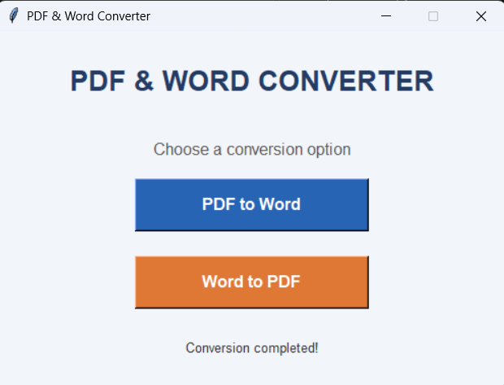

# PDF to Word Converter

A Python-based desktop application that converts PDF files into editable Word documents and Word documents into PDF files.

## Features

- PDF to Word conversion.
- Word to PDF conversion.
- Simple desktop graphical interface.
- File selection using file explorer.
- Choose the output file location.
- Success and error notifications.

## Technologies Used

- Python
- Tkinter
- pdf2docx
- docx2pdf
- PyMuPDF

## Installation

1. Clone this repository.
2. Open the project folder in VS Code.
3. Create a virtual environment:

   python -m venv venv

4. Activate the environment:

   venv\Scripts\activate

5. Install the required libraries:

   python -m pip install -r requirements.txt

## Run the Application

python pdf_word.py

## Application Image

## Usage

1. Open the application.
2. Select PDF to Word or Word to PDF.
3. Choose the input file.
4. Select the output location.
5. Complete the conversion.

## Author

YUVADHARSHINI.T
